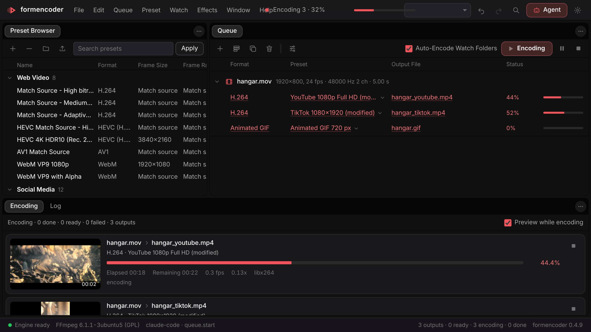
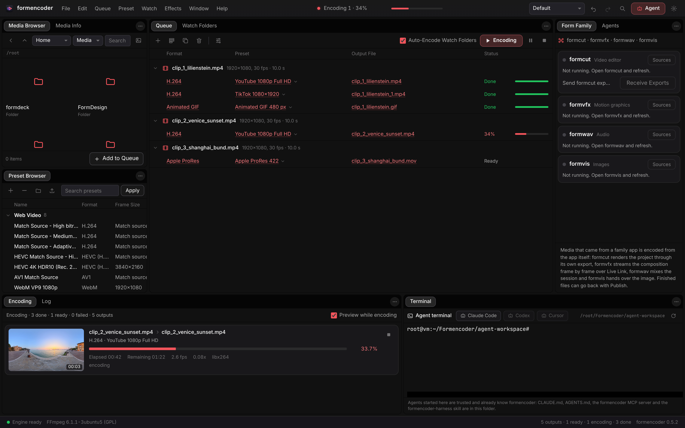
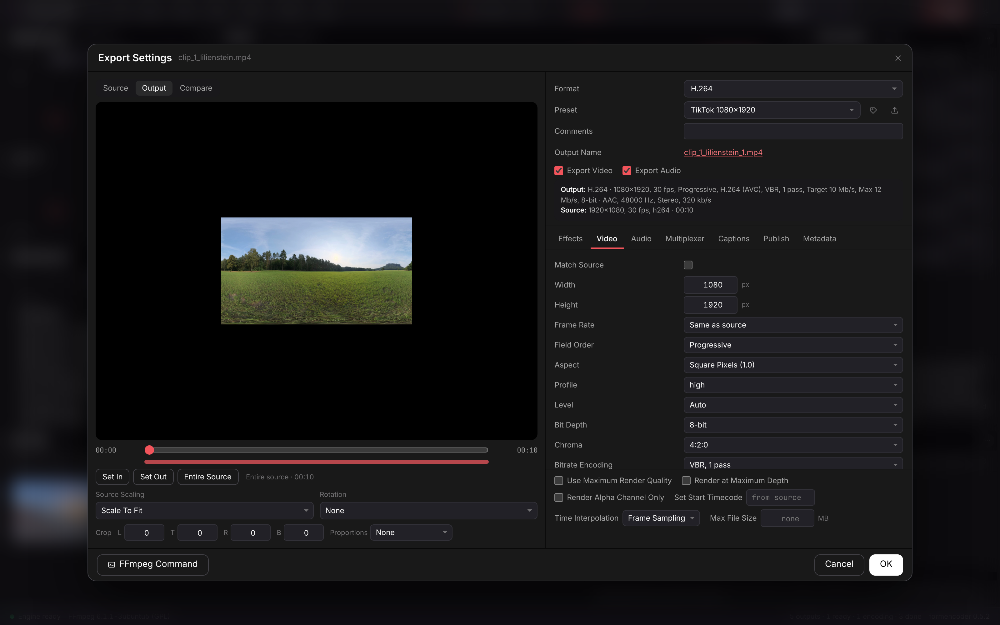
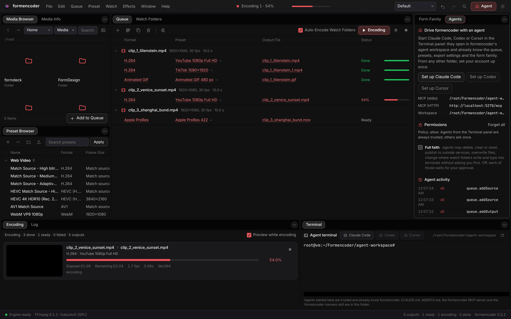
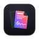

<p align="center"></p>

<h1 align="center">FormEncoder</h1>

<p align="center">
  <b>Media encoding; a queue of sources with several outputs each.</b><br>
  Presets, formats, effects, captions and delivery,<br>
  in one window, on your machine. Offline, and yours.
</p>

<p align="center">
  
  
  
  
  
  
</p>

<p align="center">
  <a href="https://formencoder.formai.studio/"><b>Download FormEncoder on formai.studio</b></a> ·
  <a href="#run-it-from-source">Run it from source</a> ·
  <a href="#the-form-family">All Form apps</a>
</p>

<br>

<p align="center">
  
  <br>
  <sub>One source, three outputs: YouTube 1080p, TikTok 1080x1920 and an animated GIF, encoding with a live preview.</sub>
</p>

<p align="center">
  <a href="#features">Features</a> ·
  <a href="#everything-in-the-box">In the box</a> ·
  <a href="#built-for-agents">Agents</a> ·
  <a href="#under-the-hood">Under the hood</a> ·
  <a href="#download">Download</a> ·
  <a href="#run-it-from-source">Run from source</a> ·
  <a href="#the-form-family">Form family</a>
</p>

<table>
  <tr>
    <td width="25%" valign="top"><h3>Many outputs per source</h3>Drag presets onto a source to add outputs, and the queue encodes them in parallel.</td>
    <td width="25%" valign="top"><h3>Presets for every delivery</h3>93 encoding presets from web and social to broadcast, cinema, DVD and Blu-ray, plus 5 ingest presets.</td>
    <td width="25%" valign="top"><h3>Own Rust engine</h3>The encoding engine is written for FormEncoder and drives a pinned LGPL FFmpeg as a separate program.</td>
    <td width="25%" valign="top"><h3>Agent-ready</h3>The UI, the command line and an MCP server run the same 96 commands, so agents can drive the queue.</td>
  </tr>
</table>

## Features

<table>
  <tr>
    <td width="33%" valign="top">
      
      <br><sub>Three sources, five outputs, with progress and a preview.</sub>
      <h3>A queue that runs itself</h3>
      Each output shows status, speed and time left. Watch folders start encodes as files arrive.
    </td>
    <td width="33%" valign="top">
      
      <br><sub>Export Settings for a TikTok 1080x1920 output.</sub>
      <h3>Every setting, one dialog</h3>
      Source, Output and Compare views, then effects, video, audio, captions, publish and metadata.
    </td>
    <td width="33%" valign="top">
      
      <br><sub>The Agents panel: set-up, permissions and an activity log.</sub>
      <h3>Agents that change the queue</h3>
      An agent adds sources and outputs live, every change undoable. Permissions are yours to set.
    </td>
  </tr>
</table>

## Everything in the box

<table>
  <tr>
    <td width="33%" valign="top"><h4>96 commands</h4>Queue with undo · Export settings · Presets · Watch folders · Ingest with checksums · Media analysis · Previews · Logs</td>
    <td width="33%" valign="top"><h4>Effects and delivery</h4>LUTs · HDR to SDR conform · Overlays · Fit Tuning · Loudness normalisation · Captions · Speech to text · Metadata and XMP · Content Credentials · Publish to folders, FTP, S3, webhooks, YouTube, Vimeo, Facebook</td>
    <td width="33%" valign="top"><h4>40 formats</h4>H.264 · HEVC · AV1 · WebM · ProRes · DNxHR · CineForm · XDCAM · JPEG 2000 MXF · AS-10 · AS-11 · P2 · DCP · DPX · OpenEXR · GIF · audio</td>
  </tr>
</table>

## Built for agents

The window, the command line and the MCP server call the same 96 commands.

```sh
./formencoder encode clip.mov --preset system/youtube-1080p   # queue, encode and print results
./formencoder queue                                           # every output and its status
./formencoder probe clip.mov                                  # media information
./formencoder mcp                                             # MCP server on stdio for Claude Code, Codex and Cursor
```

`.mcp.json`, `.codex/config.toml` and `.cursor/mcp.json` are already wired in this repo. See [`AGENTS.md`](AGENTS.md).

## Under the hood

Version 0.5.3 · Apache-2.0 · Rust encoding engine, Python service, TypeScript interface, Tauri 2 shell

- **Engine:** seven `fencoder` Rust crates in `native/`, loaded by the Python service as the `fe_core` extension.
- **FFmpeg:** a pinned LGPL build, run as a separate program and never linked.
- **Encoders:** hardware first (VideoToolbox, Media Foundation, NVENC, QSV, AMF, VA-API), found by a test encode on each machine.
- **Capabilities:** [`docs/PARITY.md`](docs/PARITY.md) traces 84 capability rows: 82 Full, 2 Partial.
- **Tested:** backend tests (engine boot, MCP, consent, captions, versions) and a browser window test.

## Download

**Get the app:** download FormEncoder from [formai.studio](https://formencoder.formai.studio/). That is the easiest way to install it.

**Keep it updated:** [FormPortal](https://github.com/nodemode-dev/formportal) installs, updates and rolls back every Form app from the same signed catalogue.

| Platform | Builds |
|---|---|
| macOS Apple silicon | Desktop app |
| macOS Intel | Desktop app |
| Linux x86_64 | Desktop app |
| Windows x64 | Desktop app |

All FormEncoder builds are compiled and released from [`nodemode-dev/formcompiler`](https://github.com/nodemode-dev/formcompiler/releases), not from this repo. This repo holds the source.

## Run it from source

Prefer it in your browser, or want to contribute? Run the web UI straight from this repo.

**Requires:** Node 20.19+ or 22.12+, Python 3.12+ and Rust 1.95+. `./formencoder doctor` checks them. FFmpeg is downloaded on first boot.

```sh
git clone git@github.com:nodemode-dev/formencoder.git
cd formencoder
./formencoder install   # engine venv, the Rust encoding engine, interface packages
./formencoder           # web UI at http://localhost:5270, engine on 127.0.0.1:8270
```

`./formencoder desktop dev` opens the desktop window instead (run `./formencoder install-desktop` first). On Windows use `formencoder.bat install`, then `formencoder.bat`.

Ports: interface 5270, engine 8270 (`FORMENCODER_PORT`). `FORMENCODER_AGENTS=allow` skips the agent permission prompt.

> [!IMPORTANT]
> **Status:** pre-release. AVC-Intra and vendor camera raw (R3D, ARRIRAW, X-OCN, Canon RAW, BRAW) are Partial, see [`docs/PARITY.md`](docs/PARITY.md).

**Contributing:** branch from `main`, keep changes to source here, and leave packaging and releases to FormCompiler. See [`.docs/BRANCHING.md`](.docs/BRANCHING.md) and [`AGENTS.md`](AGENTS.md).

## Repository

| Path | What it is |
|---|---|
| `native/` | The encoding engine: the fencoder Rust crates |
| `backend/` | FastAPI engine service, MCP server, terminal, family bridge, publish |
| `frontend/` | TypeScript and Vite interface |
| `src-tauri/` | Tauri 2 desktop shell |
| `setup/` | Scripts behind `./formencoder` |

Docs: [`.docs/wiki`](.docs/wiki) · Agents: [`CLAUDE.md`](CLAUDE.md), [`AGENTS.md`](AGENTS.md)

## The Form family

FormEncoder is one of the **Form apps**: native creative tools that install, update and roll back through FormPortal and can all be driven by agents.

| | App | What it's for | Download | Code |
|:-:|---|---|---|---|
|  | **form.md** | Documents, databases and realtime editing together | [formai.studio](https://formmd.formai.studio/) | [GitHub](https://github.com/nodemode-dev/form.md) |
|  | **FormAT** | Chat and agent workspace on your key | [formai.studio](https://format.formai.studio/) | [GitHub](https://github.com/nodemode-dev/format) |
|  | **FormCAD** | Drafting, parametric parts and NURBS surfaces | | [GitHub](https://github.com/nodemode-dev/formCAD) |
|  | **FormCel** | Spreadsheets agents can read and edit | [formai.studio](https://formcel.formai.studio/) | [GitHub](https://github.com/nodemode-dev/formcel) |
|  | **FormCraft** | Generate images, video, audio, 3D and worlds | | [GitHub](https://github.com/nodemode-dev/formcraft) |
|  | **FormCut** | Multi-track video editing with no upload | [formai.studio](https://formcut.formai.studio/) | [GitHub](https://github.com/nodemode-dev/formcut) |
|  | **FormDAM** | Photo library and asset manager | [formai.studio](https://formdam.formai.studio/) | [GitHub](https://github.com/nodemode-dev/formDAM) |
|  | **FormDeck** | Presentations and pitch decks | [formai.studio](https://formdeck.formai.studio/) | [GitHub](https://github.com/nodemode-dev/formdeck) |
|  | **FormDesign** | Page layout for print and the web | [formai.studio](https://formdesign.formai.studio/) | [GitHub](https://github.com/nodemode-dev/formdesign) |
|  | **FormEncoder** | Media encoding queue with presets | [formai.studio](https://formencoder.formai.studio/) | [GitHub](https://github.com/nodemode-dev/formencoder) |
|  | **FormFabric** | Sewing patterns draped with cloth simulation | | [GitHub](https://github.com/nodemode-dev/formfabric) |
|  | **FormLit** | Photo library and raw development | [formai.studio](https://formlit.formai.studio/) | [GitHub](https://github.com/nodemode-dev/formlit) |
|  | **FormMorpheus** | Frame-by-frame and performed animation | | [GitHub](https://github.com/nodemode-dev/formmorpheus) |
|  | **FormNET** | See what your computer sends online | | [GitHub](https://github.com/nodemode-dev/formNET) |
|  | **FormPath** | Vector illustration with artboards and type | [formai.studio](https://formpath.formai.studio/) | [GitHub](https://github.com/nodemode-dev/formpath) |
|  | **FormPDF** | Edit, redact, sign and fill PDFs | [formai.studio](https://formpdf.formai.studio/) | [GitHub](https://github.com/nodemode-dev/formpdf) |
|  | **FormPromo** | Promo films from your own media | [formai.studio](https://formpromo.formai.studio/) | [GitHub](https://github.com/nodemode-dev/formpromo) |
|  | **FormRef** | Reference boards for creative work | [formai.studio](https://formref.formai.studio/) | [GitHub](https://github.com/nodemode-dev/formref) |
|  | **FormRig** | Rig, skin and retarget any mesh | | [GitHub](https://github.com/nodemode-dev/formrig) |
|  | **FormSculpt** | 3D sculpting, remeshing and painting | [formai.studio](https://formsculpt.formai.studio/) | [GitHub](https://github.com/nodemode-dev/formsculpt) |
|  | **FormSurface** | Texture painting with PBR export | [formai.studio](https://formsurface.formai.studio/) | [GitHub](https://github.com/nodemode-dev/formsurface) |
|  | **FormTools** | Viewers, batch tools and file utilities | | [GitHub](https://github.com/nodemode-dev/formtools) |
|  | **FormTxt** | Word processing with .docx round trips | [formai.studio](https://formtxt.formai.studio/) | [GitHub](https://github.com/nodemode-dev/formtxt) |
|  | **FormVFX** | Motion graphics and VFX compositing | [formai.studio](https://formvfx.formai.studio/) | [GitHub](https://github.com/nodemode-dev/formvfx) |
|  | **FormVis** | Layered image editing with local AI | [formai.studio](https://formvis.formai.studio/) | [GitHub](https://github.com/nodemode-dev/formvis) |
|  | **FormWav** | Multitrack audio editing and mixing | [formai.studio](https://formwav.formai.studio/) | [GitHub](https://github.com/nodemode-dev/formwav) |
|  | **FormWeb** | Visual website building with a CMS | [formai.studio](https://formweb.formai.studio/) | [GitHub](https://github.com/nodemode-dev/formweb) |
|  | **FormPortal** | Install, update and roll back Form apps | [formai.studio](https://formportal.formai.studio/) | [GitHub](https://github.com/nodemode-dev/formportal) |
|  | **FormTray** | One dock icon for every app | [formai.studio](https://formtray.formai.studio/) | [GitHub](https://github.com/nodemode-dev/formtray) |
|  | **FormMCP** | One MCP connection to the family | [formai.studio](https://formmcp.formai.studio/) | [GitHub](https://github.com/nodemode-dev/formMCP) |
|  | **FormSkills** | Every app's agent skills in one place | [formai.studio](https://formskill.formai.studio/) | [GitHub](https://github.com/nodemode-dev/formskills) |
|  | **FormBench** | Parity, testing and rankings for the family | [formai.studio](https://formranker.formai.studio/) | [GitHub](https://github.com/nodemode-dev/formbench) |
|  | **FormSlot** | Codebase memory for coding agents | | [GitHub](https://github.com/nodemode-dev/formslot) |
|  | **SubForm** | Workbench for parallel Claude Code agents | | [GitHub](https://github.com/nodemode-dev/subform) |
|  | **FormCompiler** | Builds, signs and releases every app | [formai.studio](https://formcompiler.formai.studio/) | [GitHub](https://github.com/nodemode-dev/formcompiler) |
|  | **FormPipe** | Release pipeline and update feeds | | [GitHub](https://github.com/nodemode-dev/formpipe) |

---

## Maintainers

| Maintainer | Role |
|---|---|
| [@nodemode-ai](https://github.com/nodemode-ai) | Owner |
| [@gbarnai](https://github.com/gbarnai) | Co-owner |

Code owners are set in [`.github/CODEOWNERS`](.github/CODEOWNERS).

## License

FormEncoder is licensed under Apache-2.0 ([`LICENSE`](LICENSE), SPDX `Apache-2.0`). Copyright 2026 NodeAgentc, Inc. Third-party notices: [`NOTICE.md`](NOTICE.md). FFmpeg is LGPL-2.1-or-later and runs as a separate program. OpenH264 Video Codec provided by Cisco Systems, Inc.

<sub>Screenshot content: CC0 photos from Poly Haven, used as video clips.</sub>

<sub>Adobe, Media Encoder and Premiere are trademarks of Adobe. Apple and ProRes are trademarks of Apple Inc. They are named only to identify file formats and compatibility. FormEncoder is an independent project and is not affiliated with or endorsed by them.</sub>
